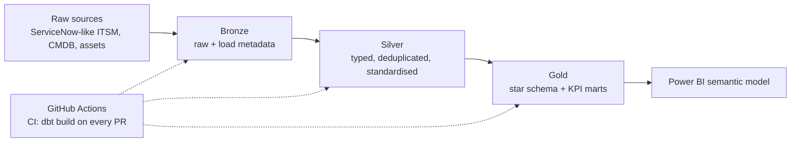

# ITSM Analytics on Microsoft Fabric with dbt


A production-style ELT project: a **Medallion (Bronze / Silver / Gold) Lakehouse** built with **dbt**, targeting **Microsoft Fabric**, with automated testing and **Git-based CI/CD**. It models IT service management data (incidents, requests, changes, assets, CMDB) into a star schema and operational KPIs (MTTR, SLA compliance, change success, backlog).

All data is **synthetic** and generated by `scripts/generate_seed_data.py`, with data-quality issues injected on purpose (duplicate incident versions, mixed casing and whitespace, mixed boolean encodings, unresolved records) so the Silver layer has real cleaning to do.

## At a glance

| | |
|---|---|
| dbt models | **45** (11 Bronze, 14 Silver, 20 Gold) |
| Data tests | **206** (generic, custom generic and singular) |
| Incremental models | 6 (merge on Fabric, delete+insert on DuckDB), latest-version-wins dedup |
| Raw sources | 11 tables (about 7,000 rows) |
| Full build + tests on DuckDB | about 5 seconds (`dbt build`) |
| Targets | `ci` (DuckDB, local and GitHub Actions), `fabric` (Lakehouse via Livy) |

## Architecture



| Layer | What it does | Examples |
|---|---|---|
| Bronze (`brz_*`) | Lands raw data unchanged, adds `_loaded_at` and `_source_table` | `brz_incidents` |
| Silver (`slv_*`) | Types, trims and normalises; parses priorities and booleans; deduplicates to the latest version; computes SLA and lead-time metrics | `slv_incidents`, `slv_incident_sla` |
| Gold (`dim_*`, `fct_*`, `kpi_*`) | Kimball star schema plus ready-to-chart KPI tables | `fct_incidents`, `kpi_sla_compliance_monthly` |

Raw tables are resolved by the `raw()` macro: seeds locally and in CI, the Fabric Lakehouse (`source('lakehouse_raw', ...)`) when the target is not DuckDB. The same code runs in both places.

## Data quality and testing

- **Generic tests:** `unique`, `not_null`, `accepted_values`, `relationships` (every fact-to-dimension and Silver foreign key).
- **Custom generic tests:** `non_negative`, `between_zero_and_one`, `not_in_future`.
- **Singular tests** (`tests/`): chronology rules, Silver deduplication actually removing rows, Gold fact reconciling with Silver, KPI sanity checks.
- **Freshness:** configured on the `incidents` source for Fabric runs.

## Quick start (local, no cloud needed)

```bash
python -m venv .venv && source .venv/bin/activate
pip install -r requirements.txt
dbt build --profiles-dir .          # seeds + models + tests on DuckDB
dbt docs generate --profiles-dir . && dbt docs serve --profiles-dir .
```

Regenerate the synthetic data (deterministic, seed 42): `python scripts/generate_seed_data.py`.

## Run on Microsoft Fabric

1. Create a Fabric workspace and a **schema-enabled Lakehouse**; load the raw tables (Delta) into it.
2. Authenticate (`az login`) or configure a service principal.
3. Set `FABRIC_WORKSPACE_ID`, `FABRIC_LAKEHOUSE_ID` and `FABRIC_LAKEHOUSE_NAME`.
4. `dbt build --profiles-dir . --target fabric`

The `fabric` profile uses the `dbt-fabricspark` adapter (Livy). Adapter option names change between versions, so check the current adapter documentation if a setting is rejected.

## CI/CD

- `.github/workflows/ci.yml`: on every pull request, installs dependencies, runs `dbt build` on DuckDB and uploads `run_results.json` and the compiled docs.
- `.github/workflows/deploy_fabric.yml`: on merge to `main` (or manually), signs in to Azure with OIDC and runs `dbt build --target fabric`. It needs the repository secrets listed in the file.

## Project layout

```
models/bronze|silver|gold   dbt models and schema tests
macros/                     raw(), flag_to_boolean(), priority_level(), generic tests
tests/                      singular tests and custom generic tests
seeds/                      synthetic raw data
scripts/                    seed data generator
docs/architecture.md        design notes and decisions
```

## Example KPIs (Gold)

`kpi_mttr_daily`, `kpi_sla_compliance_monthly`, `kpi_incident_backlog_weekly`, `kpi_change_success_monthly`, `kpi_request_fulfilment_monthly`, `kpi_incidents_by_group`, `kpi_asset_cost_by_dept`.

## Author

Kumud Khandelwal, Senior Data Engineer (Microsoft Fabric, Snowflake, dbt). [LinkedIn](https://www.linkedin.com/in/kumud-khandelwal-a8723021/)
